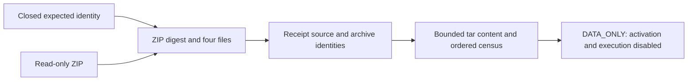

# Native source-artifact data observations

The inspector reads one original AF Actions ZIP and a closed expected identity. It returns `DATA_ONLY`,
`activationAllowed: false` and `packageExecutionAllowed: false`. It cannot download, extract files, install,
execute or activate a package. Passing data checks does not accept the producer, prove a registry publication,
establish workflow-token access or establish consumer compatibility.

The app source links, runtime and original four consumer gates remain unchanged. The old registry table
and provisional failed-producer job are removed from the native workflow. Its fixed policy still refuses
unqualified inputs. Final producer review/gates, a compatible Lens input and renderer identity remain
separate prerequisites; this DATA helper cannot activate them.

## Interface

Python callers import `inspect_artifact(zip_path, expected)` from this package. The thin facade also supports:

```sh
python3 -B scripts/native_inputs.py ORIGINAL.zip EXPECTED.json
```

Success prints a bounded identity/census summary and exits 0; refused data prints a fixed reason and exits 2.
This original inspector command has no output-directory, install or activation option. Its expected JSON has exactly these fields:

```json
{
  "outerSha256": "<64 lowercase hex>",
  "source": {
    "head": "<40 lowercase hex>",
    "tree": "<40 lowercase hex>",
    "manifestSha256": "<64 lowercase hex>",
    "lockSha256": "<64 lowercase hex>"
  },
  "archive": {
    "filename": "agentfootprint-15.0.0-rc.0.tgz",
    "package": "agentfootprint",
    "version": "15.0.0-rc.0",
    "sha256": "<64 lowercase hex>",
    "integrity": "sha512-<canonical base64 SHA512>",
    "memberCount": 1,
    "memberCensusSha256": "<64 lowercase hex>"
  }
}
```

Supply actual pinned identities; these placeholders are not accepted inputs. The census digest is this adapter's
explicit pin: preserve tar/receipt member order, normalize each object to keys `path,size,sha256` in that order,
serialize with Python `json.dumps(..., ensure_ascii=True, separators=(',', ':'))`, encode ASCII, then SHA256.
It is not an extra producer-receipt field. A distinct PR-tested commit may have the source tree; tree equality
is checked, while the hosted run/attempt/artifact/ancestry join remains the coordinator's responsibility.

## Responsibilities and bounds



- `receipt.py`: closed expectations, strict JSON, source/archive identity, SRI and complete receipt census.
- `zip_data.py`: bounded regular-file reads and exactly four canonical regular ZIP files; no extraction.
- `tar_data.py`: one bounded gzip, regular canonical tar members, full content/census comparison and terminal padding.
- `inspect.py`: data-only wiring and a summary without the member array.
- `cli.py`: arguments, read-only expected input and safe result/refusal presentation.

AF's native limits remain 32 MiB compressed tarball, 128 MiB expanded tar and 20,000 members. The outer ZIP is capped
at 64 MiB, receipt/lock at 8 MiB each and manifest at 1 MiB. Symlinks/FIFOs/nonregular inputs, ZIP path or member tricks,
duplicate JSON keys, nonfinite numbers, wrong identities/hashes, gzip concatenation, tar links/extensions,
path/case collisions and inconsistent or hidden member content are refused. This is bounded data validation,
not a replacement for the producer's native publication/member policy or its build/runtime checks.
Malformed extension-header numeric overflow and invalid ZIP DEFLATE become fixed `tar-data`/`zip-data`
refusals, including at the CLI, rather than leaking parser tracebacks.

## Cheap tests

```sh
python3 -B -m unittest discover -s scripts/native_inputs -t scripts -p '*_test.py' -v
```

Fixtures are synthetic, inert local ZIP/tar bytes. Positive cases contain an executable-looking package and
postinstall text but assert no package execution, output tree or dependency directory. Hostile cases rebind
outer/archive pins where necessary so refusal reaches the relevant content boundary. A 10,001-member positive
guards against accidentally borrowing another package's 10,000-member limit. No dependency install is needed.

## Native setup DATA seam

The earlier fixed failed-producer transport experiment has been removed. Its historical evidence remains
outside this source; it cannot be treated as a current compatibility gate. The guarded native transaction
uses the same DATA library through its public facade and the existing pinned shared-ci archive inspector.

`source_members(zip_path, expected)` returns only the original four named ZIP bodies after bounded outer
size/digest and canonical-member checks. Its expected object is exactly `filename,size,sha256`; only AF or
Lens package filenames are admitted. `parse_data` supplies the existing strict duplicate-key JSON reader.
The separate `scripts/native_source_zip.py stage|verify` entry saves or verifies these bytes in an exclusive
owned data directory. It never extracts a tar or executes package code. Original `inspect_artifact` and
its two-argument CLI remain read-only, DATA_ONLY and activation-disabled.

Only the separate fixed native setup policy can admit an independently qualified producer. Incoming tar
validation uses the shared-ci DATA port; there is no second tar parser for native setup. Missing Lens or
renderer identity refuses before transport/installation, and the standard workflow token exists only in
FETCH. PREPARE/VERIFY re-admit saved originals and carry no API token.
