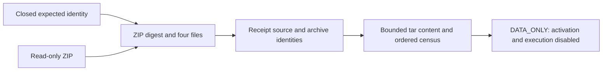

# Native source-artifact data observations

The inspector reads one original AF Actions ZIP and a closed expected identity. It returns `DATA_ONLY`,
`activationAllowed: false` and `packageExecutionAllowed: false`. It cannot download, extract files, install,
execute or activate a package. Passing data checks does not accept the producer, prove a registry publication,
establish workflow-token access or establish consumer compatibility.

The existing app dependency preparation, source links, runtime, tests and workflows are unchanged. In particular,
the old registry pins in `prepare-ci-dependencies.mjs` do not become a supported new install through this helper.
Final producer review/gates, a compatible Lens input and transport admission remain separate prerequisites.

## Interface

Python callers import `inspect_artifact(zip_path, expected)` from this package. The thin facade also supports:

```sh
python3 -B scripts/native_inputs.py ORIGINAL.zip EXPECTED.json
```

Success prints a bounded identity/census summary and exits 0; refused data prints a fixed reason and exits 2.
There is no output-directory, install or activation option. The expected JSON has exactly these fields:

```json
{
  "outerSha256": "<64 lowercase hex>",
  "source": {
    "head": "<40 lowercase hex>",
    "tree": "<40 lowercase hex>",
    "manifestSha256": "<64 lowercase hex>",
    "lockSha256": "<64 lowercase hex>"
  },
  "archive": {
    "filename": "agentfootprint-15.0.0-rc.0.tgz",
    "package": "agentfootprint",
    "version": "15.0.0-rc.0",
    "sha256": "<64 lowercase hex>",
    "integrity": "sha512-<canonical base64 SHA512>",
    "memberCount": 1,
    "memberCensusSha256": "<64 lowercase hex>"
  }
}
```

Supply actual pinned identities; these placeholders are not accepted inputs. The census digest is this adapter's
explicit pin: preserve tar/receipt member order, normalize each object to keys `path,size,sha256` in that order,
serialize with Python `json.dumps(..., ensure_ascii=True, separators=(',', ':'))`, encode ASCII, then SHA256.
It is not an extra producer-receipt field. A distinct PR-tested commit may have the source tree; tree equality
is checked, while the hosted run/attempt/artifact/ancestry join remains the coordinator's responsibility.

## Responsibilities and bounds



- `receipt.py`: closed expectations, strict JSON, source/archive identity, SRI and complete receipt census.
- `zip_data.py`: bounded regular-file reads and exactly four canonical regular ZIP files; no extraction.
- `tar_data.py`: one bounded gzip, regular canonical tar members, full content/census comparison and terminal padding.
- `inspect.py`: data-only wiring and a summary without the member array.
- `cli.py`: arguments, read-only expected input and safe result/refusal presentation.

AF's native limits remain 32 MiB compressed tarball, 128 MiB expanded tar and 20,000 members. The outer ZIP is capped
at 64 MiB, receipt/lock at 8 MiB each and manifest at 1 MiB. Symlinks/FIFOs/nonregular inputs, ZIP path or member tricks,
duplicate JSON keys, nonfinite numbers, wrong identities/hashes, gzip concatenation, tar links/extensions,
path/case collisions and inconsistent or hidden member content are refused. This is bounded data validation,
not a replacement for the producer's native publication/member policy or its build/runtime checks.
Malformed extension-header numeric overflow and invalid ZIP DEFLATE become fixed `tar-data`/`zip-data`
refusals, including at the CLI, rather than leaking parser tracebacks.

## Cheap tests

```sh
python3 -B -m unittest discover -s scripts/native_inputs -t scripts -p '*_test.py' -v
```

Fixtures are synthetic, inert local ZIP/tar bytes. Positive cases contain an executable-looking package and
postinstall text but assert no package execution, output tree or dependency directory. Hostile cases rebind
outer/archive pins where necessary so refusal reaches the relevant content boundary. A 10,001-member positive
guards against accidentally borrowing another package's 10,000-member limit. No dependency install is needed.

## One provisional hosted transport probe

The separate `Native input data (provisional)` CI job is a read-only development probe, not the runtime check.
It pins the actual earlier producer run, attempt, successful package job, artifact and complete data identity
in `provisional_af_d3.json`. The whole producer run is explicitly failed; the probe cannot turn that into
producer acceptance. A successor needs a new reviewed binding, never a moving branch or latest-artifact lookup.

`probe.py` is the sixth cohesive unit: fixed provider metadata admission and one bounded `gh api` read path.
Its dedicated CLI is `scripts/probe_native_input.py`, which calls the closed `probe_main` entry on the
package facade. External callers never import the private `probe.py` module. The generic static Python
script-boundary test derives sealed packages at every depth and checks absolute and relative imports;
dynamic import expressions are not claimed to be covered. It runs only in this repository's Actions context,
requires the step's supplied token, uses an empty temporary gh configuration and does not read a desktop login.
The token is supplied only to that API step; headers, token values, debug/authentication output and raw provider
errors are never printed. A 403/404 fails with a fixed reason; no retry or different credential route follows.

The job uses preinstalled Python and GitHub CLI, listed in the official
[Ubuntu24.04 runner inventory](https://github.com/actions/runner-images/blob/main/images/ubuntu/Ubuntu2404-Readme.md),
and checks their availability again. There is no dependency installation or producer rebuild. Metadata must
join the exact source/tree, run/attempt, successful named package/upload steps and artifact name/digest/size
before the original ZIP is requested once. It stays in a private temporary folder and is deleted after the
data inspection, even on refusal. Only the small summary is retained; the ZIP is not uploaded again.

Desktop access did not establish that this workflow's token can read another repository's artifact. This job
measures that capability directly and can fail honestly. The old runtime job and its older package pins remain
unchanged and unaccepted for the new cohort. A green data observation does not establish installation, runtime,
native acceptance, registry provenance, producer whole-CI success or target compatibility.
