# Closed native dependency setup

`prepare-ci-dependencies.mjs` is the workflow-only facade for PREFLIGHT → FETCH → PREPARE → VERIFY.
The fixed source policy binds independently admitted AgentFootprint and Lens originals, published engine14RC,
Foottrace2.1, context0.1.1, and the exact published renderer 2.0.0 image tested with the current Lens original.
These are source/registry input facts, not an App compatibility verdict. PREFLIGHT is the first shell after
checkout/Node setup, before even the global resolver install. It cannot be skipped or ignored; every
later stage checks qualification independently.

The five temporary requests are exact published engine14.0.0-rc.0/Foottrace2.1.0, original accepted AF/Lens
archives, and one exact compatible published renderer. Unknown links/roles/workspaces refuse. The authored
source links, historical Foottrace caret, package version, public lock and all app behavior remain unchanged.
The historical lock is not a fabricated published AF15 lock. The native lock is genuinely regenerated from
that baseline for only these five requests, then strict npm ci runs the original lifecycle hooks.
The baseline contains obsolete source links. npm naturally reconciles changed versions, but can retain
a same-version link when the request changes to exact registry origin. Only that proven origin-cache
case is refreshed, across the controlled requests: validate the authored link/target and remove its
two cache rows, refusing shared or unknown targets. Every unrelated/compiler row is preserved; npm
authors all replacement version/URL/SRI records. One pure selected-origin validator runs before ci and
again after install. The original public lock is restored exactly even if resolution fails.
Metadata generation uses no-argument `npm install --package-lock-only --ignore-scripts` against the five
projected requests. Named `npm update` can seek an unpublished registry peer despite a valid local TAR.
An offline inert local-TAR peer regression runs the actual recipe without creating node_modules or
executing lifecycle scripts; strict peer/force-false policy is retained.

```mermaid
flowchart LR
  fixed[Closed accepted source and registry facts] --> preflight[PREFLIGHT: metadata and immutable source]
  preflight --> fetch[FETCH: read-only token/API]
  fetch --> data[Original ZIP and provider receipts]
  data --> prepare[PREPARE: no token]
  prepare --> admit[Re-admit outer digest, source and original members]
  admit --> temporary[Five request projection and strict install]
  temporary --> restore[Restore original bytes and modes even on refusal]
  restore --> gates[Original test, strict types, lint and build]
  gates --> verify[VERIFY: prior-step digest and fresh re-admission]
```



## Ownership

- `projection.mjs`: pure five-request transformation, preserving unrelated fields and the original input.
- `admission.mjs`: fixed roles, exact provider attempt/source/tested parents/gate closure and original archive
  identity. Only the actual named AF docs failure can be excepted; Lens gates must succeed. Package contents
  are inspected through the existing pinned shared-ci DATA facade, never a second tar reader.
- `lens.mjs`: the actual nine-body compatibility format, not an AF candidate wrapper. All original
  outer/body hashes,115 Lens members, actual tested build receipt and immutable raw Git manifest are
  checked. The committed source lock is a separate anchor: the native build explicitly records a
  modified generated lock. It is never described as a clean source/build-lock equivalence.
  The real Lens/context manifests have publishConfig, which the shared publication-route inspector
  rejects. Only those admitted digest/SRI-pinned images use its public readArchiveMembers DATA port
  plus exact manifest/member/root checks. No config is stripped, package rebuilt or publication rule
  changed. Engine/reader retain the strict shared inspector. The retained renderer TAR passed that
  inspector as DATA proof; production uses its qualified npm SRI and all14 installed member hashes,
  without another renderer TAR fetch. This is nonpublishing input observation.
- `transport.mjs`: one-attempt workflow-token GETs, strict metadata joins and saved-original re-admission.
  A403/404 is a failure with no credential fallback. Only FETCH has the standard workflow token.
  The CLI working directory and its config/state/cache/data directories are all inside the intake.
  Lens raw immutable Git manifest/lock bodies live separately from the unmodified nine-body ZIP.
- `filesystem.mjs`: bounded regular files, immutable Git sources, exact byte/mode restoration and minimal
  token-free npm environment with separate empty user/global configuration files.
- `namespaces.mjs`: actual App and source-helper namespaces, hidden/nested aliases and locks plus the one
  admitted common-parent dependency link. Directory links inside dependencies refuse; declared bin links
  are checked against the actual installed package boundary under node_modules, including scoped and
  nested packages. An inner module-format or forged manifest grants no bin authority. Targets stay
  inside that package, and its installed namespace must match the link's actual .bin namespace.
  This does not assume a root-only graph.
- `installed.mjs`: original AF/Lens members, one physical engine/reader/context owner, actual renderer SRI,
  resolution from every family/source owner, genuine normal/hidden locks and unchanged compiler image.
  Engine/reader/context members must match the original admitted TAR images before the first gate,
  not only an initial self-snapshot. Expected context version/SRI is fixed0.1.1 from the admitted input.
  Every published-renderer member matches the qualified current matrix original.
- `transaction.mjs`: fixed stage wiring, exclusive prepare attempt, strict lock/install and unconditional
  restoration. The original document bytes/modes are independently joined to immutable consumer Git HEAD.
  VERIFY checks an immutable prior-step checkpoint digest, re-admits original ZIP/TGZ/receipts against the
  fixed policy and observes all installed/source/compiler/lock images again.
  The mandatory npm ls argv runs while the temporary native manifest/lock are active. Its exit0,
  receipt and log hashes join the external checkpoint; then exact public bytes/modes are restored
  before the four original consumer commands. No wrong-phase graph command checks native images
  against the restored local-development requests, and no graph failure is ignored.

The AF example checkout is the exact admitted source head. Its helper intentionally imports AF source;
it is not claimed to come from the packed archive. Its tracked source inventory, manifest/lock hashes,
HEAD/tree, absence of ignored injected files and shared dependency resolution are guarded. It receives
no separate dependency install or producer build.

`scripts/native_inputs.py` keeps its DATA_ONLY inspector. The public package facade additionally exposes
bounded `source_members` for the actual AF four named original ZIP bodies and `compatibility_members`
for the actual Lens nine named bodies; `scripts/native_source_zip.py` stages
or checks those bytes as data only. Neither extracts a tar or imports package code. The old failed-producer
transport experiment and obsolete registry table are removed, with their historical proof kept outside
this source. The native workflow uploads only compact receipts, manifests, native lock and command logs;
no npm cache, dependency/build tree or duplicate producer archive is uploaded.

Cheap dependency-free controls:

```sh
node --test scripts/prepare-ci-dependencies/*.node-test.mjs
python3 -B -m unittest discover -s scripts/native_inputs -t scripts -p '*_test.py' -v
```

Fixtures contain inert executable-looking text but never load it. They check source/member/compiler/lock
changes, partial-failure restoration, staged-only changes, hidden obsolete readers in both namespaces,
dangling/foreign links, provider identity and pre-effect refusal. These are source controls, not a native
installation or whole consumer proof. Hosted tests, strict declarations, lint, build and exact-head review
remain required before acceptance. No publication or registry-AF claim is made.
