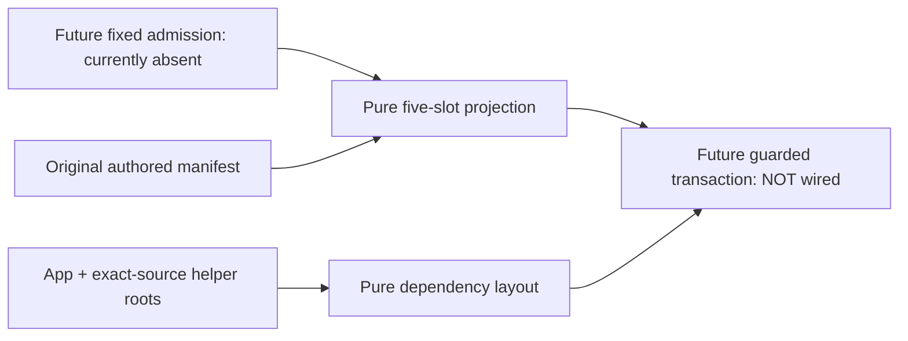

# Pure native dependency preparation

This sealed folder replaces the obsolete published10/10.1/0.76 preparation table. It contains pure
planning functions only. The direct script deliberately refuses before filesystem/child effects:
the complete native runtime integration and qualified Lens source input are not configured yet.
This partial source is not a working CI route or a consumer compatibility claim.

`prepare-ci-dependencies.mjs` is the facade. `projection.mjs` owns the five CLOSED temporary requests:
exact engine13.0.0/Foottrace2.0.0, two original AF/Lens archive locators, and an exact published-renderer
policy. The four authored source links and Foottrace caret are validated; unknown file links in any
dependency section, added workspaces and unknown policy roles refuse. The input and all unrelated
manifest fields remain unchanged. The future transaction must restore the exact original bytes/modes.

The supplied NATIVE_SOURCE_READY object is already-admitted DATA, not an authority generated here.
Its shape alone does not verify a producer. The future fixed provider admission must bind source,
run/attempt/tested tree/parents, gates, original manifest/lock/archive/SRI/members and published renderer
metadata before passing it. There are no Lens IDs/version/profile or live input bindings in this folder.
Tests use clearly synthetic archive paths and renderer bytes; none are production candidates.

`namespaces.mjs` owns only the existing app/source-helper layout: the app and its sibling exact-source
AF checkout have independent dependency namespaces, plus their existing common-parent dependency link.
This is lexical planning, not a realpath/symlink check, physical census, installed-owner proof or claim
that the source helper comes from the public archive. A future observer must canonicalize actual paths,
scan all nested/hidden aliases and locks, include every actual context owner and verify one engine/FT root.



Dependency-free focused controls:

```sh
node --test scripts/prepare-ci-dependencies/*.node-test.mjs
```

The existing Vitest request-boundary controls remain in test/ci-dependencies.test.ts and use the facade.
No app runtime/test/lint/build workflow or features change in this preparation. Final implementation must
replace the obsolete source checkout/pins/provisional DATA job coherently and preserve all four original
gates. No package install, producer/archive execution, version relabel or registry-readiness claim is made.
